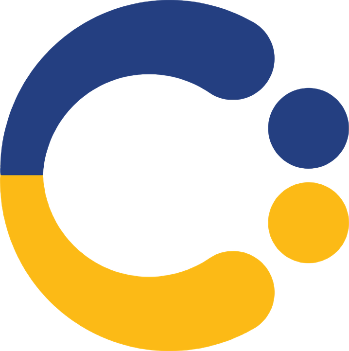
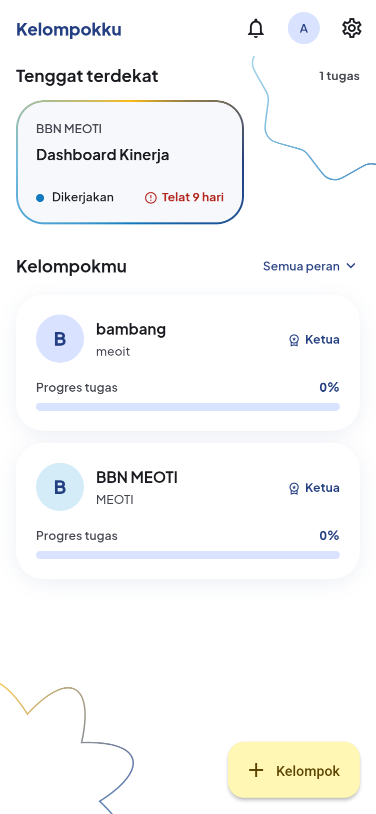
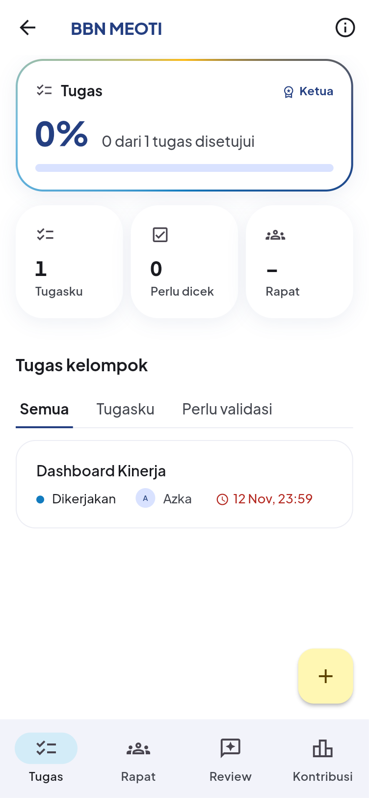
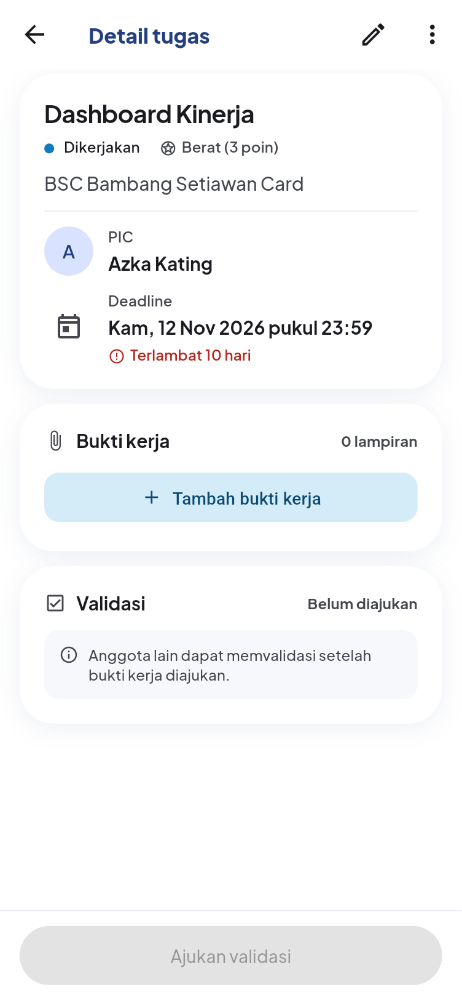
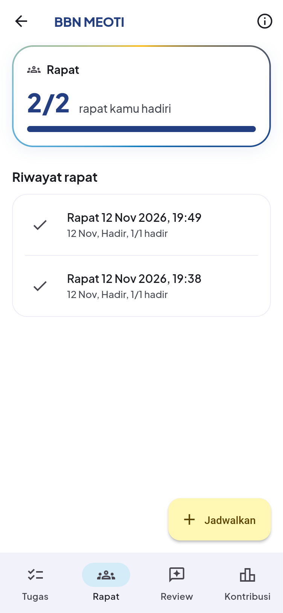
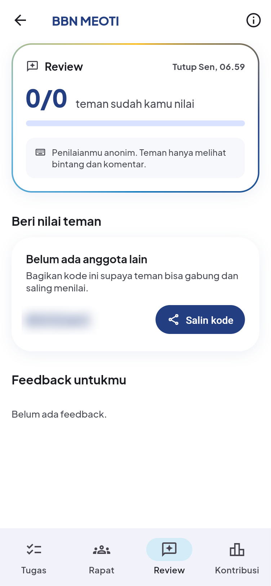
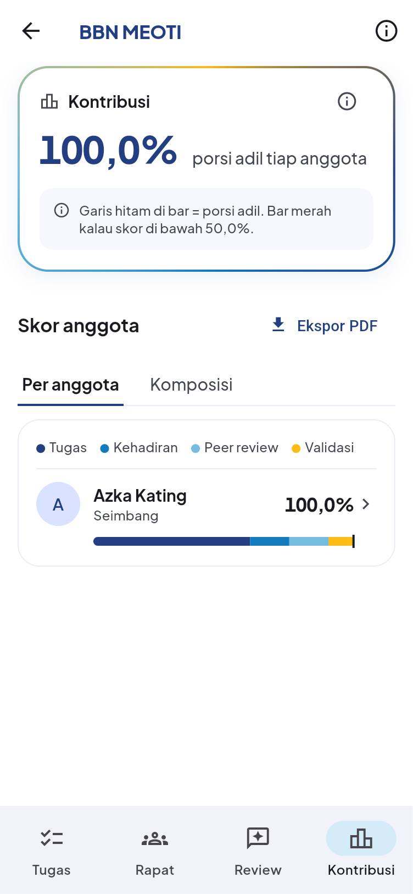
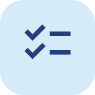
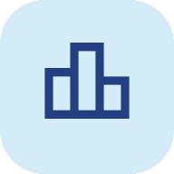

<p align="center">
  
</p>

<h1 align="center">Collab</h1>

<p align="center">
  <b>Kerja bareng, nilai adil.</b><br>
  Aplikasi pencatat kontribusi tugas kelompok: siapa mengerjakan apa, lengkap dengan buktinya.
</p>

<p align="center">
  
  
  
  
</p>

<p align="center">
  Final Project Teknologi Berkembang C · Kelompok 2 · ITS 2026
</p>

## Tampilan aplikasi

<table align="center">
  <tr>
    <td align="center"><br><sub><b>Beranda</b><br>Ringkasan kelompok</sub></td>
    <td align="center"><br><sub><b>Papan Tugas</b><br>PIC, bobot, deadline</sub></td>
    <td align="center"><br><sub><b>Detail Tugas</b><br>Bukti kerja & validasi</sub></td>
  </tr>
  <tr>
    <td align="center"><br><sub><b>Rapat</b><br>Absen pakai QR</sub></td>
    <td align="center"><br><sub><b>Peer Review</b><br>Penilaian anonim</sub></td>
    <td align="center"><br><sub><b>Kontribusi</b><br>Skor tiap anggota</sub></td>
  </tr>
</table>

## Fitur utama

| | Fitur | Isinya |
|:-:|---|---|
|  | **Tugas** | Ketua bagi tugas dengan PIC, bobot, dan deadline. Anggota upload bukti, lalu divalidasi teman lain. |
|  | **Rapat** | Ketua jadwalkan rapat. QR absen berganti tiap 30 detik, jadi tidak bisa titip absen. |
|  | **Peer review** | Tiap minggu anggota saling menilai secara anonim. |
|  | **Kontribusi** | Semua data dihitung jadi skor. Anggota yang jauh di bawah rata-rata dapat tanda ⚠️. |

## Nama dan deskripsi aplikasi

**Masalah.** Di tugas kelompok sering ada anggota yang kerja keras dan ada yang cuma numpang nama. Dosen dan teman sekelompok susah membuktikan siapa mengerjakan apa, jadi nilai individu sering tidak adil.

**Pengguna.** Mahasiswa yang mengerjakan tugas kelompok (ketua dan anggota), serta dosen yang ingin melihat kontribusi tiap anggota.

**Cara Collab membantu.** Setiap tugas punya PIC, bobot, deadline, dan bukti pengerjaan yang divalidasi anggota lain. Absensi rapat memakai QR yang berganti terus, ada peer review anonim, lalu semua data itu dihitung menjadi **skor kontribusi** tiap anggota. Anggota yang skornya jauh di bawah rata-rata diberi tanda ⚠️.

## Rencana fitur dan screen

| Screen | File | Fungsi |
|---|---|---|
| Login | `login_screen.dart` | Masuk dengan email & password |
| Daftar | `register_screen.dart` | Buat akun baru |
| Daftar kelompok | `groups_screen.dart` | Lihat kelompok, buat atau gabung pakai kode |
| Beranda kelompok | `group_home_screen.dart` | 4 tab: tugas, rapat, peer review, kontribusi |
| Task board | `task_board_screen.dart` | Daftar tugas realtime + filter "Tugasku" |
| Form tugas | `task_form_screen.dart` | Tambah dan ubah tugas (PIC, bobot, deadline) |
| Detail tugas | `task_detail_screen.dart` | Bukti kerja, submit, validasi, tombol ubah/hapus untuk ketua |
| Rapat | `meetings_screen.dart` | Daftar rapat dan absensi |
| QR rapat | `meeting_qr_screen.dart` | QR absen yang berganti tiap 30 detik |
| Scan QR | `scan_qr_screen.dart` | Anggota scan untuk absen |
| Peer review | `peer_review_screen.dart` | Nilai anggota lain secara anonim |
| Kontribusi | `contribution_screen.dart` | Skor kontribusi tiap anggota + tanda ⚠️ |

## Struktur folder

Mengikuti struktur di PPT Week 2: layar di `lib/screens/`, layanan eksternal di `lib/services/`, pengujian di `test/`.

```
collab/
├── lib/
│   ├── main.dart        # pintu masuk aplikasi
│   ├── app.dart         # MaterialApp + tema
│   ├── screens/         # semua layar (UI)
│   ├── services/        # akses Supabase (auth, kelompok, tugas, rapat, peer review)
│   ├── models/          # bentuk data: Group, Task, Contribution
│   ├── widgets/         # widget & dialog yang dipakai ulang
│   └── utils/           # env, tema, validator, format tanggal, pesan error
├── assets/images/       # gambar lokal (terdaftar di pubspec.yaml)
├── test/                # pengujian, jalankan dengan flutter test
├── supabase/schema.sql  # skema database + aturan akses
├── docs/                # rumus skor kontribusi
└── pubspec.yaml         # library dan asset
```

Aturannya: **screen tidak boleh memanggil Supabase langsung**, selalu lewat file di `services/`.

## Pembagian tugas

Sesuai proposal (bagian 3.3 Pembagian Screen per Anggota):

| # | Anggota | Screen |
|:-:|---|---|
| 1 | Azka | Login, Daftar, Profil, Pengaturan, Notifikasi + kerangka app, tema, skema database |
| 2 | Farel | Daftar Kelompok, Beranda, Tambah/Buat/Gabung Kelompok, Info Kelompok |
| 3 | Aludra | Papan Tugas, Rapat, Jadwalkan Rapat, Detail Kehadiran |
| 4 | Gergi | Detail Tugas, Tambah Bukti Kerja, Tolak Tugas |
| 5 | Rezzel | Form Tugas, Kode QR Rapat, Matriks Penilaian, Pilih PIC & Tenggat |
| 6 | Maria | Kontribusi, Detail Kontribusi, Cara Menghitung Skor, Ekspor PDF |
| 7 | Zahra | Peer Review, Pindai QR |

## Status fitur

| Fitur | Status |
|---|---|
| Login / daftar / logout | ✅ |
| Buat & gabung kelompok pakai kode, info anggota, keluar kelompok | ✅ |
| Task board realtime + filter "Tugasku" | ✅ |
| Tambah tugas (PIC, bobot, deadline) | ✅ |
| Bukti kerja berupa link + submit + validasi | ✅ |
| Rapat + QR berganti tiap 30 detik + scan absen | ✅ |
| Peer review anonim mingguan | ✅ |
| Skor kontribusi + tanda ⚠️ | ✅ |
| Ubah & hapus tugas | ✅ |
| Ubah & hapus rapat, bukti kerja, peer review | ✅ |
| Notifikasi pengingat deadline | ✅ |
| Upload bukti file/foto ke Storage | ⬜ Gergi |
| Grafik kontribusi + export PDF | ⬜ Maria |

## Setup

1. **Kunci Supabase.** Salin `env.example.json` menjadi `env.json`, lalu isi `SUPABASE_URL` dan `SUPABASE_PUBLISHABLE_KEY` (minta ke ketua).
   `env.json` tidak ikut di-commit. **Jangan pernah** memakai `service_role`/secret key.
2. **Jalankan**
   ```bash
   flutter pub get
   flutter run --dart-define-from-file=env.json
   ```
   Tanpa `--dart-define-from-file=env.json` aplikasi hanya menampilkan "Kunci Supabase belum diisi".
   Pintas di Windows: `.\run.bat` menyalakan emulator Android (kalau belum hidup), menunggu sampai siap, lalu menjalankan app dengan env.json.
   Di VS Code, buka folder `collab` lalu pilih konfigurasi **Collab** di Run and Debug.
   Di Android Studio, pilih **Collab** di dropdown Run (dari `.run/Collab.run.xml`, flag sudah terisi).

Perintah lain dari PPT:

| Perintah | Fungsi |
|---|---|
| `flutter analyze` | Cek warning dan error |
| `flutter test` | Jalankan semua test di folder `test/` |
| `flutter pub get` | Unduh dependencies |
| `flutter clean` | Bersihkan cache build kalau ada error aneh |

## Pengumpulan (dari PPT)

**Laporan kelompok** (link Drive, nama file `NamaKelompok_Collab.pdf`, contoh `Kelompok15_Collab.pdf`), isinya:
1. Cover dan nama anggota
2. Daftar isi
3. Nama dan deskripsi aplikasi
4. Rencana fitur dan screen aplikasi
5. Progress (UI Figma atau kode Dart)
6. Halaman terakhir: tabel kontribusi anggota (tanggal, nama, kontribusi)

**Logbook** (satu spreadsheet kelompok, week 11–14, submit ulang linknya tiap minggu di intip.in/ProgressKelompokTEKBER26). Isi tiap minggu:
- Pembagian tugas tiap anggota
- Yang dikerjakan
- Hambatan
- Rencana minggu depan

Update logbook dulu sebelum submit. Anggota yang tidak berkontribusi tidak dapat nilai kelompok untuk weekly progress.

## Aturan Git

- Satu branch per fitur, misalnya `feat/edit-hapus-tugas` atau `feat/upload-bukti`.
- Jangan push langsung ke `main`. Buat Pull Request dan minta 1 teman me-review.
- Sebelum PR, pastikan `flutter analyze` dan `flutter test` lulus.
